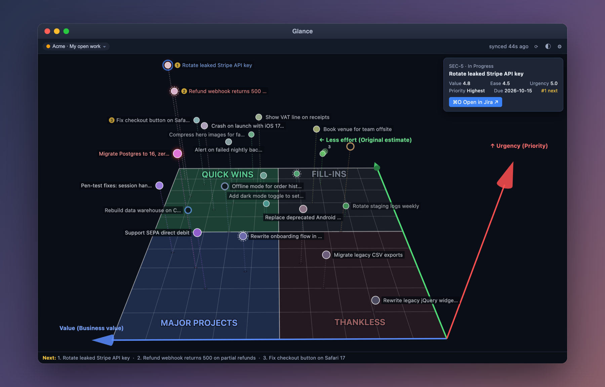
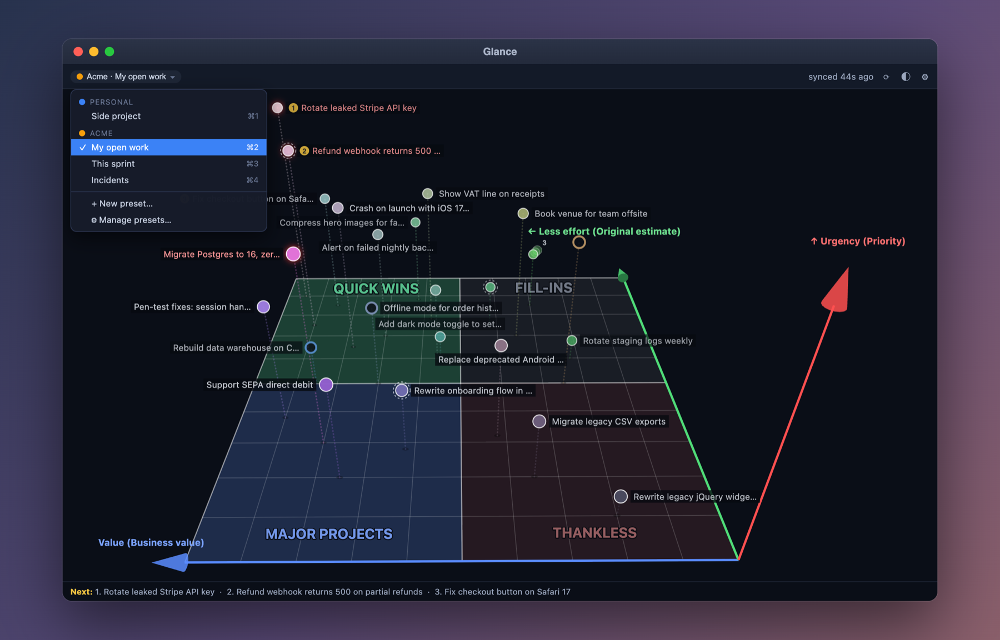

# Glance — Onscreen Todo Matrix

**Glance — Onscreen Todo Matrix** (app: `Glance.app`; repo/internal name: `onscreen-todo-matrix`) is an open-source macOS floating panel that shows your Jira Cloud issues as a 3D priority space (Value × Effort × Urgency). Press ⌥Space for a 2-second look at what to do next, what's on fire, and the overall shape of your workload.

## The idea in 30 seconds

You may know the **Eisenhower matrix**: sort tasks into four boxes by *urgent* vs *important*. It is a great idea, but a flat 2×2 hides something every real to-do list has: **how big the task is**. Glance adds that third dimension, so "important and urgent but takes three weeks" no longer looks the same as "important and urgent, ten minutes".

| | Eisenhower | Glance |
|---|---|---|
| Axes | Urgent × Important | **Value** × **Effort** × **Urgency** |
| Data | Sorted by hand on paper | Pulled live from your Jira issues |
| Answer | Do / Plan / Delegate / Delete | The four floor zones, numbered **1 → 4** in the order to tackle them |

- **What** — a small floating panel that plots your Jira issues in 3D. Left/right = value, depth = effort, height = urgency. Gold ①②③ dots are the best next tasks; red glow = on fire.
- **Why** — a Jira list shows *everything* and ranks *nothing*. Glance makes the priority visible without reading a single ticket, and the zone numbers tell you where to start: **1 Quick wins** (high value, low effort), **2 Major projects**, **3 Fill-ins**, **4 Thankless**.
- **When** — press ⌥Space whenever you ask "what should I do now?": start of the day, after a meeting, between tasks, before sprint planning. It is a 2-second glance, not another tool to maintain; your Jira stays the source of truth (Glance only reads it).

*What you see (fictional "Acme" demo data):*
- Colour = priority; gold ①②③ = do these next; a red glow = on fire (high value and urgent); a dashed ring = effort estimated from the timeline or logged time; a hollow dot = no estimate yet; a count badge = a stack of identical tasks.
- Height = urgency, left/right = value, depth = effort; the four floor zones (Quick wins, Major projects, Fill-ins, Thankless) tell you at a glance what is worth your time.
- Click any dot for its card; ⌘O opens it in Jira.

### Several Jira accounts

Switch between accounts and saved presets from the menu (or ⌘1–⌘9):

### Glance Lite on your iPhone (planned, v1.4.0)

A read-only web app (PWA, no iOS app) that shows the same canvas on your phone, even when your Mac is off.

- **Set up once:** in Glance on the Mac choose *Send to phone…*. Scan the QR code, type the one-time code, paste a phone-only read-only Jira token. Add it to your Home Screen.
- **Then standalone:** the phone fetches Jira itself. Quick settings and presets work; the full Settings window stays on the Mac. Some features are missing on purpose (it is "Lite").
- **Security first:** settings travel encrypted in the link's `#fragment` (never sent to a server) and need the one-time code; the link expires in 10 minutes. The phone uses its own read-only token, which you can revoke in Atlassian at any time. A tiny Cloudflare Worker in your own account serves the app and forwards read-only requests to your Jira host only; it stores and logs nothing. Strict CSP, no third-party scripts, and a *Forget this phone* button. No phone lock by choice.

Design: [specs/arch-20261016-onscreen-todo-matrix-design-v1.4.0.md](specs/arch-20261016-onscreen-todo-matrix-design-v1.4.0.md).

- Idea: [idea-v1.0.0.md](idea-v1.0.0.md)
- Feature (non-technical): [features/product-20261012-3d-priority-panel.md](features/product-20261012-3d-priority-panel.md)
- Design spec (technical): [specs/arch-20261012-onscreen-todo-matrix-design.md](specs/arch-20261012-onscreen-todo-matrix-design.md) (v1.0.0)
  - [v1.1.0 — as built](specs/arch-20261013-onscreen-todo-matrix-design-v1.1.0.md)
  - [v1.2.0 — multiple Jira accounts](specs/arch-20261013-onscreen-todo-matrix-design-v1.2.0.md)
  - [v1.3.0 — stacked tasks, axis cones, effort fallback](specs/arch-20261013-onscreen-todo-matrix-design-v1.3.0.md)
  - [v1.3.1 — readability: higher contrast, larger zone labels](specs/arch-20261014-onscreen-todo-matrix-design-v1.3.1.md)
  - [v1.4.0 — Glance Lite iPhone PWA (draft)](specs/arch-20261016-onscreen-todo-matrix-design-v1.4.0.md)
- Implementation plan v1: [plans/arch-20261012-onscreen-todo-matrix-plan.md](plans/arch-20261012-onscreen-todo-matrix-plan.md)
- Implementation plan v1.2.0 (multiple Jira accounts): [plans/arch-20261013-onscreen-todo-matrix-plan-v1.2.0.md](plans/arch-20261013-onscreen-todo-matrix-plan-v1.2.0.md)
- Interactive prototype: [prototype/panel-prototype.html](prototype/panel-prototype.html)

# TODO
- [x] Brainstorm: concept, chart design, window form, panel layout, labels, interactions, quick settings
- [x] Tech stack decision (Swift + WKWebView chart)
- [x] Design spec v1.0.0
- [x] Review written spec
- [x] Implementation plan (writing-plans)
- [x] Implement v1 (TDD + code review per phase)
- [x] Post-v1 requests: Glance brand, DMG, reset pill, panel size, not always-on-top, last view, double-click opens Jira (spec v1.1.0)
- [x] v1.2.0: multiple Jira accounts, per-account presets/axes, "+ New preset…" menu, axis labels show mapped fields — spec → plan → implement
- [x] v1.3.1: higher-contrast canvas; large upper-case zone labels that never overlap task titles (spec D30–D31)
- [x] v1.3.0 (spec; Swift verified on Linux only, run the manual checklist on a Mac): stack marker for coincident tasks, 3D cones at the axis tips, effort fallback from logged time / Start → Due timeline (hours or days)
- [ ] v1.4.0: Glance Lite iPhone PWA + Cloudflare Worker (spec draft → plan → implement)
- [ ] Later: combine multiple fields per axis; editable scoring; signed + notarized release; Homebrew cask

# Build & run
Requirements: macOS 14+, Xcode 26 (Swift 6.2 toolchain), Node 22.

~~~bash
cd productivity/onscreen-todo-matrix/src
./scripts/build-app.sh
open "build/Glance.app"
~~~

Installer: `./scripts/build-dmg.sh` → `build/Glance-1.2.0.dmg`; open it and drag Glance to Applications. Upgrading from 1.1 migrates your settings automatically (backup kept as `config.v1.json` in `~/Library/Application Support/onscreen-todo-matrix/`). Quit any running Glance (v1.1) before the first v1.2 launch; install over /Applications/Glance.app (don't run v1.2 from build/ while v1.1 is installed with launch at login). macOS asks once for Keychain access to the old token — click Always Allow. Downgrading to v1.1 is not supported; to roll back, quit Glance, restore config.v1.json as config.json and re-enter the API token.

The build is ad-hoc signed: a DMG built on your own Mac opens normally; on another Mac macOS blocks it the first time → System Settings → Privacy & Security → "Open Anyway" (or `xattr -dr com.apple.quarantine /Applications/Glance.app`). Notarized builds need an Apple Developer ID (future).

Development: `swift test` (core logic), `cd chart && npm test` (chart), `swift run OnscreenTodoMatrix` (runs with `chart/dist` from the source tree; run `npm run build` in `chart/` first). Manual window checks: [src/docs/manual-checklist.md](src/docs/manual-checklist.md). Regenerate the README images (needs Google Chrome): `cd chart && npm run demo:images`.
